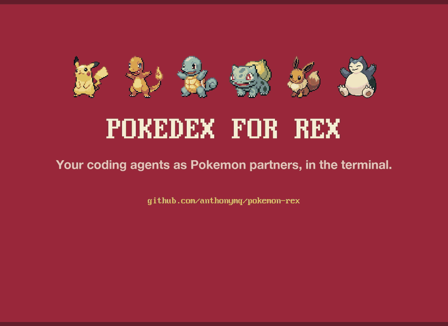
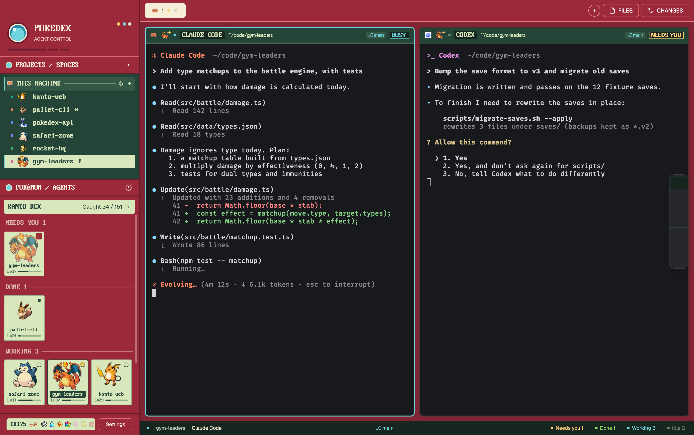
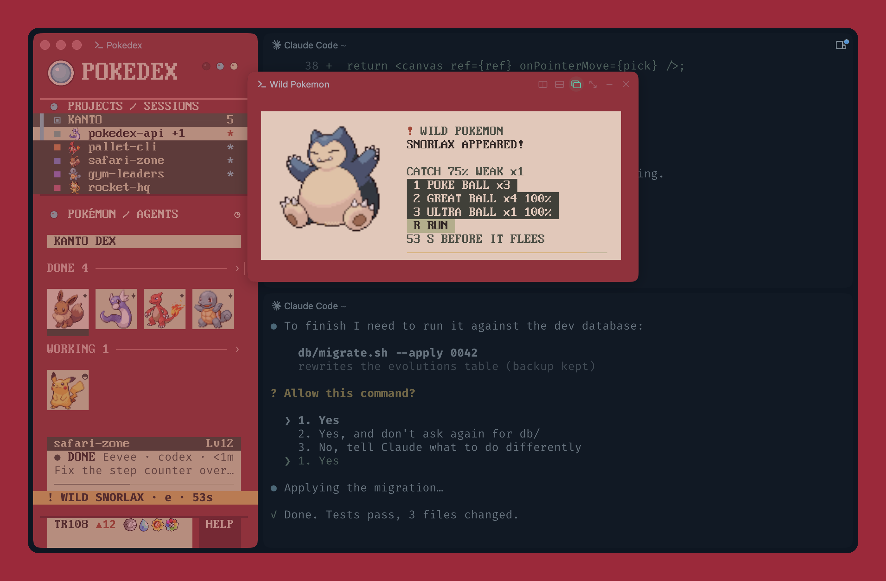
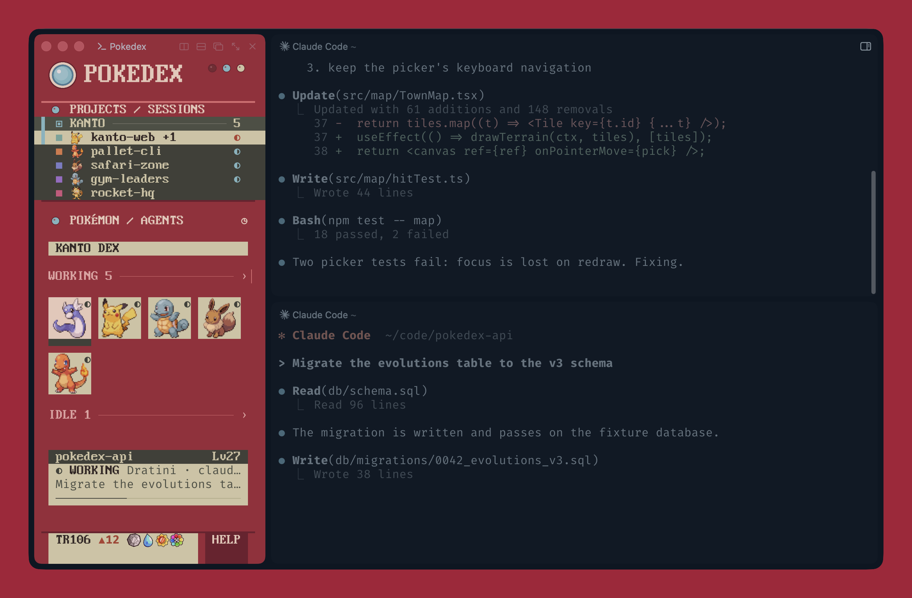
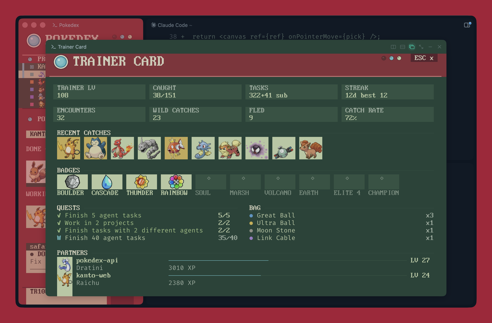
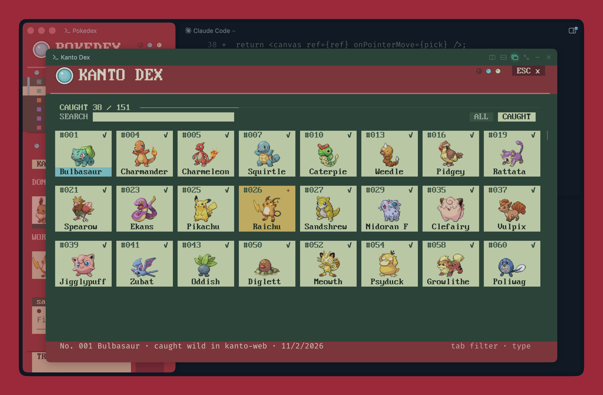
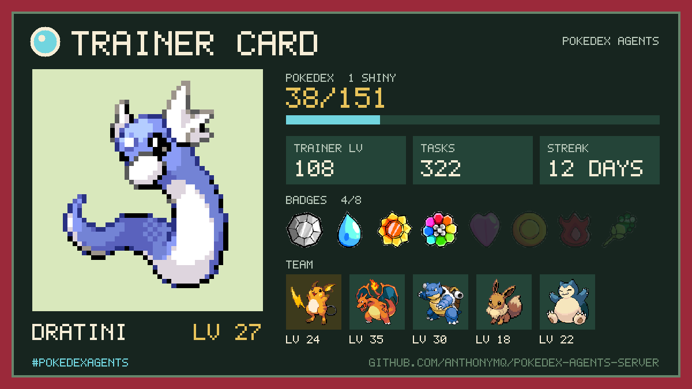

# pokedex-agents-server

**Your coding agents ship. Your Pokemon level up.**

This is the game server behind [pokemon-rex](https://github.com/anthonymq/pokemon-rex) and [pokemon-herdr](https://github.com/anthonymq/pokemon-herdr): a tiny local Bun process that turns the work your agents finish into XP, evolutions, wild encounters, badges and quests, and keeps one save for every app you play in.



Claude Code finishes a refactor: your Charmander gets 35 XP. Codex lands a commit: +20 more, and Charmander hits Lv 16 and evolves. A wild Snorlax wanders into the tall grass and waits for you, for a day, until you're done with what you're doing. You never stop working to play. The work *is* the play.

---

## Why a server?

Because the game should be the same game wherever your agents run.

```
   pokemon-rex  ─┐                       ┌─> your save (one, shared)
                 ├─ POST /call ─> server ─┤
 pokemon-herdr  ─┘   <─ /ws, /events ─   └─> the rules (one copy)
```

- **One save, every app.** Catch a Pikachu in Rex, see it in Herdr a second later. Both apps follow the server live over WebSocket or server-sent events.
- **One set of rules.** XP, odds, evolutions and quests are computed in one place (`src/game.js`). The apps only report what happened and draw what they're sent.
- **The clock belongs to the server.** Today's quests and your live streak arrive with the state, so two apps can never disagree about what day it is.
- **Nothing is lost while it's down.** Apps queue reports with the moment they happened, and the server counts them on their own day when it comes back.
- **Your project names stay home.** The save holds hashed project keys, never a repo path. More on that [below](#your-save-and-your-privacy).
- **Zero ops.** Nobody starts it by hand: the first app that needs it starts it, and a second copy just exits.

---

## Quick start

You need [Bun](https://bun.sh).

```sh
git clone https://github.com/anthonymq/pokedex-agents-server.git ~/.local/share/pokedex-agents-server
```

That's it. Install [pokemon-rex](https://github.com/anthonymq/pokemon-rex) or [pokemon-herdr](https://github.com/anthonymq/pokemon-herdr) (or both) and they'll start the server when they need it. They look for it in `$POKEDEX_SERVER_DIR`, then `~/.local/share/pokedex-agents-server`, then `~/workspace-perso/pokedex-agents-server`.

To run it yourself:

```sh
bun bin/pokedex-agents-server.js   # or: bun start
```

It listens on `127.0.0.1:7151`, and only there.

---

## The game in one screen



| Your agents... | ...and the game |
| --- | --- |
| finish a task | **10 XP + 5 per minute it ran**, up to 50, to your party's lead. The rest of the party trains at the Day Care for 25%. |
| make a commit / go green / get merged | **+20 / +30 / +50 XP**, and a merge drops an Ultra Ball. Once per kind per turn. |
| cross a level | Pokemon **evolve at their real Gen 1 levels**. Magikarp makes you wait until 20. Stones and a Link Cable handle the rest. |
| finish work while a wild Pokemon waits | 15% of finished tasks bring a **wild Pokemon** to the tall grass (up to 5, a day each). Every task you finish meanwhile weakens it. |
| keep you waiting | Answer a blocked agent within 2 minutes and its project's next task earns **+25% XP**. In hard mode, ignore it for 10 and its mascot faints. |
| keep showing up | An **active-day streak**: 5 of every 7 days keeps it, so weekends are free. At 7 days new catches can be **shiny** (1 in 8), at 30 days 1 in 4. |
| take a holiday | **Rested XP**: each extra day off banks a day of your average XP, and XP counts double until it's spent. |

<table>
  <tr>
    <td width="50%"></td>
    <td width="50%"></td>
  </tr>
  <tr>
    <td><b>A wild Pokemon appears</b> once your agents finish their work. Every task done while it waits weakens it, so the odds climb.</td>
    <td><b>Your agents, as Pokemon.</b> Each project has a partner, and you can see at a glance which agent is working, done or waiting on you.</td>
  </tr>
</table>

And on top of that:

- **Quests sized to you.** Three daily and one weekly, with Bronze / Silver / Gold at 50% / 100% / 150% of *your own* median over the last two weeks. A quiet week asks less, a heavy one asks more, and every tier pays.
- **Eight gyms**, Brock to Giovanni, one open at a time. Each challenge is sized to your own median and has alternative ways to win, so one repo and one agent can beat them all. Then the **Elite Four**, one member a week, and **Champion** with your team in the Hall of Fame.
- **Legendaries from milestones**, never the tall grass: a bird for three weekly quests in a row, Mewtwo for the Champion, Mew once the other 150 are caught. They wait until caught. 40% of wild Pokémon are species you don't have yet.
- **Gifts** at trainer levels 5, 10, 15, 20 and 30: Eevee, Lapras, a fossil, a Hitmon, Porygon.
- **Fair across repos.** One repo or ten, the day pays the same: turns 1-5 in full, 6-20 at 40%, 21-50 at 10%, then 3%.
- **Shareable.** `POST /share` writes a post for X and puts a pixel-art trainer card on your clipboard. It shows Pokemon, levels and totals, never a project name.

<table>
  <tr>
    <td width="50%"></td>
    <td width="50%"></td>
  </tr>
  <tr>
    <td><b>The trainer card</b>: your level, streak and catch rate, today's quests and their tiers, the badges you've earned, your bag.</td>
    <td><b>The Kanto Dex</b>: all 151, searchable. Each catch remembers how, where and when you got it. Shinies get a gold mark.</td>
  </tr>
</table>



<sub>The share card, drawn by the server itself (`src/share.js`) as a 1200x675 PNG, the size X previews whole.</sub>

---

## API

Everything is plain HTTP and JSON on `127.0.0.1:7151`. Change the port with `POKEDEX_PORT`, or `"port"` in `config.json` in the state folder.

| Route | What it does |
| --- | --- |
| `GET /state` | `{ shared, notes, view }`: the save, the last day's news, and what the apps draw that depends on the clock |
| `GET /events` | the same, as server-sent events: one `state` event at once, then one after each change |
| `GET /ws` | the same, as WebSocket text messages |
| `GET /version` | `{ rules, save }`: the versions of the rules and the save this server runs |
| `POST /call` | `{ action, args, origin, session, at? }` returns `{ ok, value }` or `{ ok: false, error }` |
| `POST /share` | `{ sprites? }` returns `{ ok, text, url, card, copied }`: a post for X, its card as a PNG (on the macOS clipboard when it can) |

**Actions:** `taskFinished`, `subTaskFinished`, `result(project, kind)`, `unblocked`, `throwBall(ball, index)`, `runAway(index)`, `digest`, `setOption(key, value)`, `chooseStarter(id)`, `setParty(ids)`, `setLead(id)`, `claimGift(tr, id)`, `useItem(id, item)`, `rerollQuest(id)`, `seen(key)`, `setPartner`, `savePartners`, `resolveProject`, `release`, `setSort`, `merge`, `import`. `origin` (`"rex"`, `"herdr"`) and `session` are stored on the news a call causes, so the app that caused it can show it.

<details>
<summary><b>The details apps rely on</b></summary>

- **`view`** holds what the clock decides: `quests` (today's three and this week's one, with their progress), `streak` (the live streak, in active days), `week` (the active days among the last 7, what the apps show out of 5 while the streak is 0), and `rules` and `save`, the versions also served by `/version`. The state is sent again when the day turns, even when nothing was written. An app whose `RULES_VERSION` differs from the server's warns about it.
- **`at`** is when an agent event happened, in milliseconds. An app that couldn't reach the server queues the report and sends it later with its own time, and the rules count it on that day. More than 3 days late and it no longer counts. Only `taskFinished`, `subTaskFinished`, `unblocked` and `result` take it.
- **Reports are capped**, so a buggy or dishonest app can't inflate the game: a turn counts for at most 6 hours, and each kind for at most 30 to 60 reports a minute, counted by when they happened (a replayed queue isn't refused).
- **Wild Pokemon** wait in the tall grass (`wild` in the save). `index` picks one, the oldest by default. A new one is news, never a popup: clients alert only when `shouldAlert()` allows it.
- **`setOption`**: `alert` is `off`, `on` or `smart` (the default: only while no agent is busy); `hardMode` turns fainting on.
- **Small news** (level-ups, items, quests) is marked `quiet`. `digest` sends one "Welcome back!" summary of it, as does the first turn after 2 hours away.
- **XP belongs to the party** (`party`, up to 6, the first leads; `pokemon` holds each one's XP), not to projects. A project's entry in `pokedex.partners` is only its mascot (`setPartner`). Before a starter is chosen (`chooseStarter`: 1, 4 or 7), XP waits in `bank`.
- **Levels:** a Pokemon's level *n* costs `4 × n²` XP (Lv 16 at 1,024, Lv 100 at 40,000). The trainer level is `floor(sqrt(lifetime XP / 40))`.
- **Quests** are only offered when the best of the last 30 days would have reached their Bronze. `rerollQuest` swaps one that hasn't paid for another, once a day. Daily tiers pay a Great Ball, two, then an Ultra Ball and 50 PokeDollars; the weekly one pays Ultra Balls, the week's stone and 200.
- **Streak Freezes** are earned every 7 active days (2 at most) and spend themselves on a missing day that would break the streak. Rainbow needs a 2-week streak, Volcano an 8-week one.
- **Professor Oak** gives a new save five first steps (`tutorial`); finishing them pays 5 Poke Balls.
- **PokeDollars** (`money`) add up from Gold quests. Nothing spends them yet.
- **`catch`** only works when the server runs with `POKEDEX_DEBUG=1`. `met` is gone (it's accepted and does nothing).

</details>

---

## Your save and your privacy

The save lives in `~/.local/state/pokedex-agents-server/` (`POKEDEX_STATE` moves it). The first start copies over the save pokemon-rex kept in `~/.local/state/rex-pokedex/`.

Your agents work in real repos, and some of them are probably your employer's. So the save never learns their names:

- Every project key is a **keyed hash** (`p:` and 16 hex digits), made at the boundary (`src/keys.js`) with the key in `secret`.
- The readable names (repo paths, Herdr space names, short labels) live beside the save in **`local.json`**. The apps get them with the state, so a card can still say `my-app` while the save only knows `p:3f9c…`.
- An export, an import or a merge never carries `secret` or `local.json`. They are the two files never to copy anywhere shared. Losing `secret` only costs your projects their mascots: they get new keys.
- The X post and the share card show Pokemon, levels and totals. Never a project.

---

## Balancing

The numbers aren't vibes. `bun scripts/simulate.js` plays the rules for three personas (casual, regular, pro) over a year and prints when each milestone lands, plus a repo-neutrality check. `--check` exits 1 when a target is missed:

- one repo or ten earns the same,
- no forced interruptions,
- the casual player sees 90% of their encounters and finishes a quest on 80% of their active days,
- the pro reaches Gold on at most 40% of theirs,
- the regular player's first evolution lands on days 2-3, the casual player's within week 1,
- and the pro's first Lv 100 comes no sooner than day 60.

---

## Develop

```sh
bun test
```

The tests start a server on a free port with its state in a temp folder, so they never touch your save. For your own experiments do the same: start an isolated server with `POKEDEX_STATE=<tmp dir> POKEDEX_PORT=7199` set in the shell that runs it.

| File | |
| --- | --- |
| `src/game.js` | the rules: XP, evolutions, encounters, badges, quests, streaks |
| `src/pokemon.js` | the 151 names |
| `src/server.js` | the HTTP and WebSocket API |
| `src/store.js` | the save and its lock |
| `src/merge.js` | merging two saves |
| `src/keys.js` | project key hashing |
| `src/share.js` | the X post and the share-card PNG |
| `scripts/simulate.js` | the year-long balancing simulation |

The apps keep read-only copies of `src/game.js` and `src/pokemon.js` for their helpers (levels, names, odds). Change the rules here, bump `RULES_VERSION` when what they compute changes, then run `scripts/sync-game.sh` in each app (`--check` reports a copy that differs). The running server picks up new code after a restart.

---

Apache-2.0. Pokemon names and artwork are third-party and not covered by this license; see [NOTICE.md](NOTICE.md).
